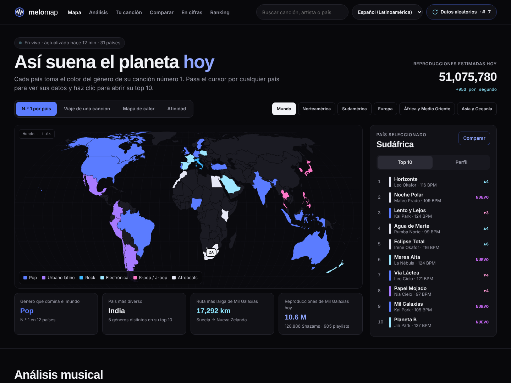
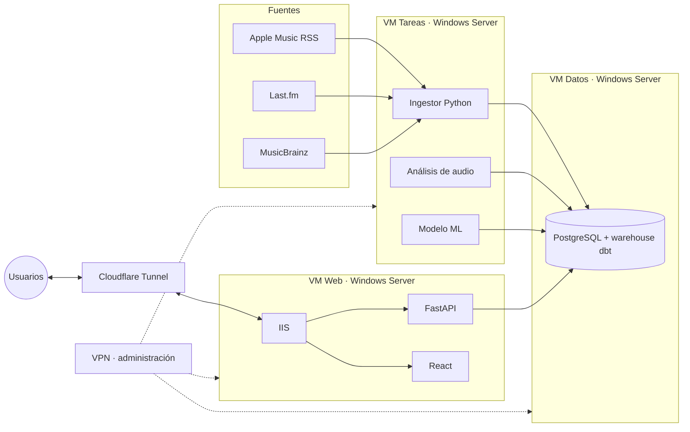

<p align="center">
  
</p>

<h1 align="center">MeloMap</h1>
<p align="center"><strong>Lo que suena en el mundo, ahora mismo.</strong></p>

<p align="center">
  <a href="https://github.com/TU-USUARIO/melomap/actions/workflows/ci.yml"></a>
  
  
  
</p>

MeloMap sigue los charts musicales de 31 países, analiza el audio de cada canción (BPM, tonalidad, energía), predice cuáles serán hits y lo muestra en un mapa interactivo. Es un proyecto de portfolio que cubre de punta a punta: datos, machine learning, backend, frontend, servidores Windows y despliegue.

> **Estado:** fase 0 de 10 · fundamentos y estructura del proyecto.



## Qué hace

- **Mapa del mundo** con el número 1 de cada país, el viaje de una canción día a día, mapa de calor por género y afinidad musical entre países.
- **Ficha de cada canción:** BPM, tonalidad, acordes, créditos, huella sonora y probabilidad de ser hit.
- **Análisis:** duelo entre canciones, pulso de escucha por hora, comparador de países, cifras globales y ranking.
- **Quiz** que recomienda la canción del momento según tus gustos.
- En **español latino e inglés**.

## Arquitectura



| Capa | Tecnologías |
| --- | --- |
| Lenguaje y calidad | Python 3.12 · type hints · uv · Ruff · mypy · pre-commit |
| Datos | PostgreSQL · SQLAlchemy · Alembic · dbt · pandas · NumPy · SciPy · Polars |
| Machine learning | scikit-learn · LightGBM · SHAP · MLflow |
| Backend | FastAPI · Pydantic · pytest · coverage |
| Frontend | React · TypeScript · Vite · d3-geo |
| Infraestructura | Windows Server · Hyper-V · IIS · Cloudflare Tunnel · VPN · PowerShell |
| CI/CD y operación | GitHub Actions · Dependabot · gitleaks · Grafana · Loki · Uptime Kuma |

## Ejecutar en local

Requisitos: Windows 10/11, [Git](https://git-scm.com/) y [uv](https://docs.astral.sh/uv/).

```powershell
uv sync                         # instala Python 3.12 y todas las dependencias
uv run pre-commit install       # activa las revisiones antes de cada commit
uv run melomap-countries        # primer comando del proyecto
```

## Comandos de calidad

```powershell
uv run ruff check .             # malas prácticas
uv run ruff format .            # formatea el código
uv run mypy                     # verifica los type hints
uv run pytest                   # tests + cobertura (mínimo 90 %)
```

## Estructura

```text
melomap/
├─ apps/ingest/        Ingesta de datos (fase 0: carga y validación de países)
├─ apps/api/           API con FastAPI (fase 7)
├─ apps/web/           Frontend React (fase 8)
├─ warehouse/          Data warehouse con dbt (fase 4)
├─ ml/                 Notebooks y modelo (fases 5 y 6)
├─ db/                 Migraciones de base de datos (fase 2)
├─ config/             Configuración en YAML, sin secretos
├─ infra/              IIS, PowerShell, Cloudflare, VPN y monitoreo
└─ docs/               Guías por fase, decisiones (ADR) y diseño
```

## Documentación

- [Guía de la fase 0](docs/fases/fase-0.md)
- [Decisiones de arquitectura](docs/adr/)
- [Identidad visual y pantallas](docs/design/)
- [Cómo contribuir](CONTRIBUTING.md) · [Seguridad](SECURITY.md) · [Cambios](CHANGELOG.md)

## Licencia

[MIT](LICENSE)
